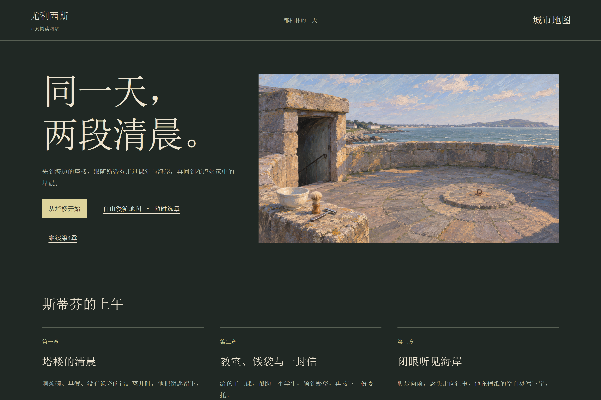
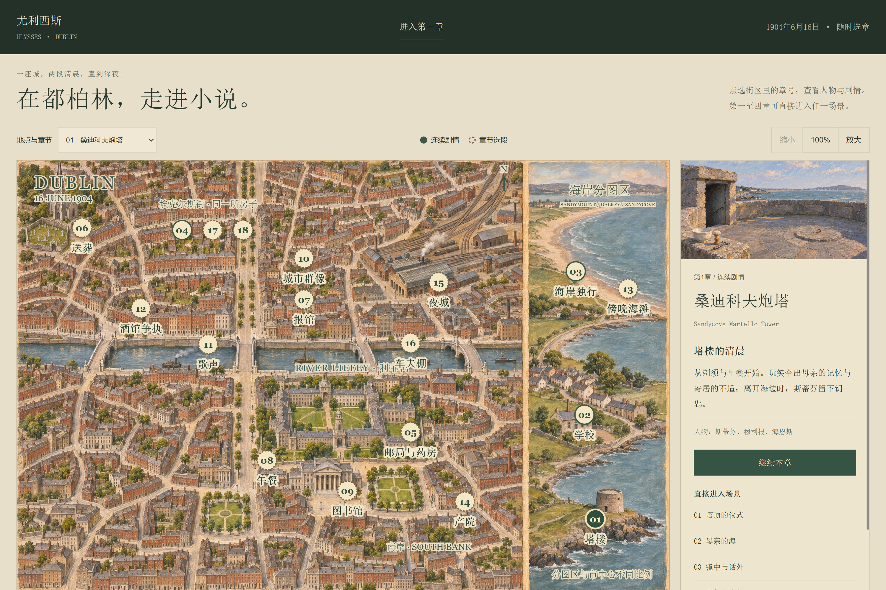
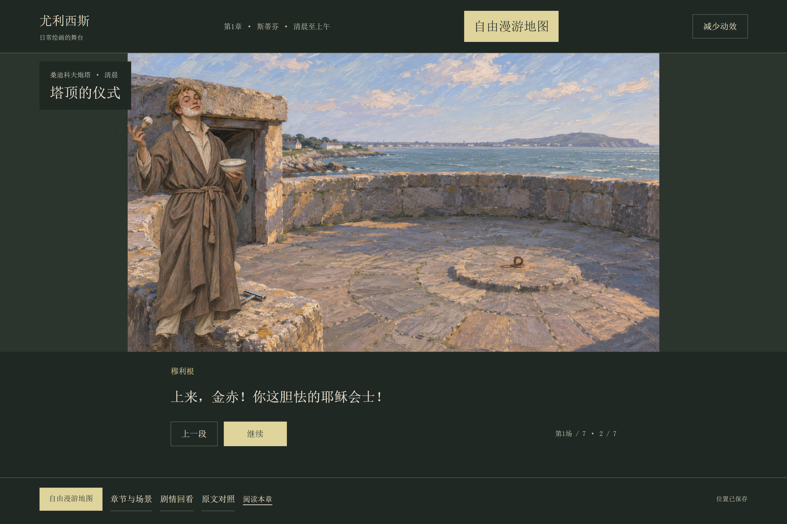
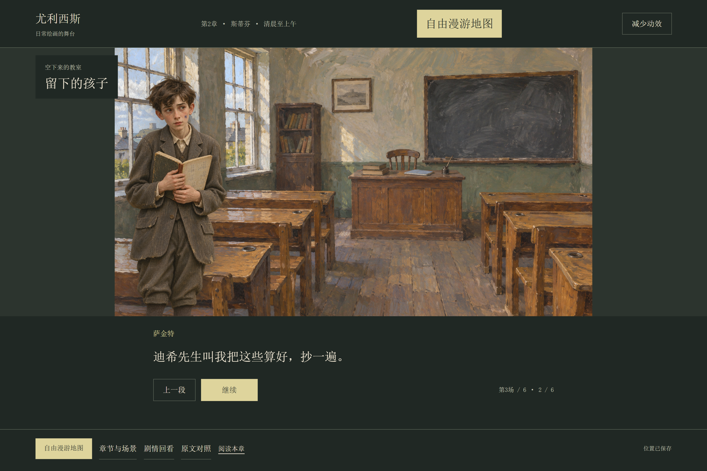
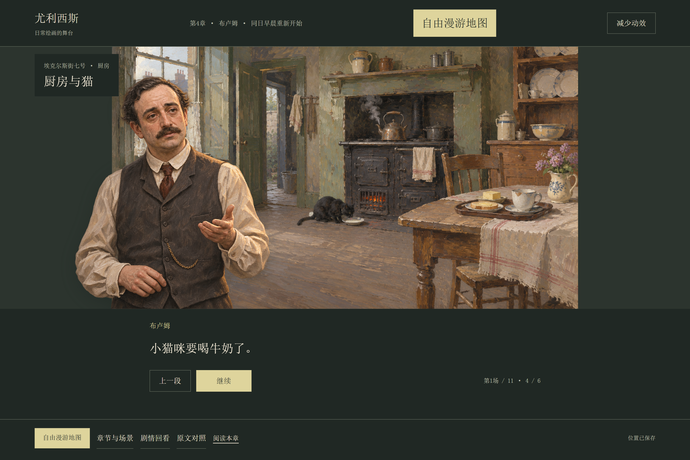
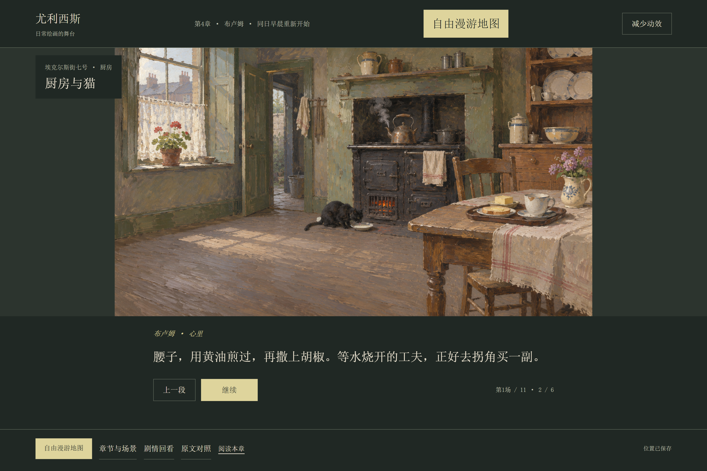
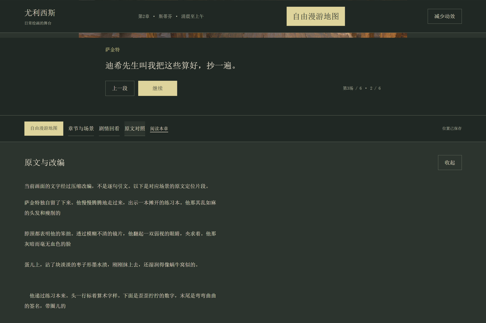

# 《尤利西斯》· 都柏林的一天

**用一张城市地图、一场场对话，走进乔伊斯笔下的一天。**

《尤利西斯》的阅读困难，既来自意识流，也来自人物、地点、回忆与叙述方式的不断切换。本项目将小说的情节和人物处境转为可进入的油画舞台，让读者先看清“谁在何处经历什么”，再回到文字。

[进入游戏](https://zhihanxie78-cloud.github.io/ulysses-dublin/app/index.html) · [自由漫游地图](https://zhihanxie78-cloud.github.io/ulysses-dublin/app/map.html) · [阅读网站](https://zhihanxie78-cloud.github.io/ulysses-dublin/网站/dist/index.html)



## 两个独立入口

| 入口 | 内容 |
| --- | --- |
| 剧情游戏 | 从斯蒂芬清晨的塔楼出发，切换至布卢姆的日常；从城市地图自由进入章节。 |
| 可视化阅读网站 | 全书十八章导览、人物与地点档案、图像手札，以及章节阅读材料。 |

玩家采用原著人物视角，沿着小说已有的故事展开。游戏与阅读网站相互连接，也可以分别使用。

## 一张可以自由选章的都柏林地图

十八章地点入口全部开放。地图标记连接章节、人物和具体场景，部分地点附当代地图查询入口。



底图为艺术化鸟瞰，街道关系经过压缩；海岸和墓地以分区呈现，不作历史测绘或现实导航依据。

## 谁在说话，谁就走到舞台前

对话配合对应人物立绘，旁白、说出口的话与内心独白分别呈现。部分场景包含人物入场、回忆浮现、转场与冲突震动，可使用“减少动效”。





## 从日常走进人物的内心

早餐、猫、茶和来信，构成布卢姆清晨的具体行动；未说出口的念头让同一场景拥有另一层情绪。





## 从游戏回到小说

场景提供对应原文定位片段，并与阅读网站连接。改编对白不冒充逐字引文；人物内心、书信、回忆及幻景应结合具体语境辨认。




本页八张配图均为实际桌面网页截图，原图尺寸为 **3000 × 2000**，点击可查看大图。

## 当前内容范围

- 十八章均有地图入口、导览与阅读材料。
- 第一至四章提供连续剧情，共三十场、一百九十九个压缩改编节拍。
- 第五至十八章目前提供选段体验，尚未完成全书逐场连续改编。
- 角色插图是艺术演绎；不作为历史人物肖像或1904年街景证据。

## 本地使用

下载仓库ZIP并完整解压，在项目根目录运行：

```sh
python -m http.server 8766 --bind 127.0.0.1
```

然后在浏览器打开：

- 游戏：http://127.0.0.1:8766/app/index.html
- 地图：http://127.0.0.1:8766/app/map.html
- 阅读：http://127.0.0.1:8766/网站/dist/index.html

静态页面无需Node、npm、API密钥或后端服务。保持目录结构完整，图片与脚本必须随项目一并保留。阅读位置与动效偏好保存在当前浏览器本地；不同设备不会自动同步。

## 目录

```text
app/                 城市地图、连续剧情、人物立绘和场景动效
网站/dist/            全书阅读、人物地点档案及后续章节选段
docs/screenshots/    八张真实网页版高清截图
index.html          游戏入口
```

## 作品、图像与使用说明

原作：James Joyce, *Ulysses*。中文阅读资料依据项目所用萧乾、文洁若译本；译文及相关资料权利属于相应权利人。原始PDF、私人工作资料与账号凭据未上传。项目用于文学阅读与交互改编探索，保留来源说明不代表取得了第三方材料的再分发许可。

界面中的章节节拍含压缩改编；请以原著为准。图像含AI生成的油画场景、人物艺术演绎与整理素材，更多说明见阅读网站“作品与图像来源”。仓库公开可查看；代码、图像及译文的授权范围须分别确认，未统一声明第三方材料适用开源许可。


## 添加到桌面

游戏页面左下角提供“添加到桌面”入口。支持安装提示的浏览器可点击“安装游戏”；iPhone或iPad请在Safari的分享菜单中选择“添加到主屏幕”。安卓和电脑也可从Chrome或Edge菜单安装。页面会说明不同设备的步骤。添加后仍需联网，浏览器本地进度不会自动跨设备同步。
